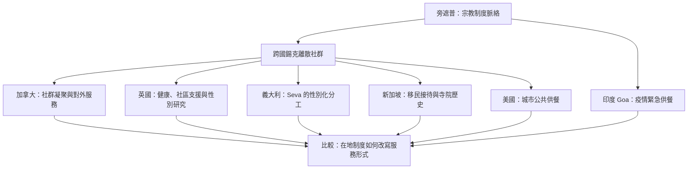

Langar 隨錫克社群跨國移動，在不同地方與移民接待、公共服務、健康促進及危機應變相互連結。比較研究應保留各地歷史、社群結構與制度差異，而非把案例視為同質的複製品。

## 概念連結
* [[Langar]] · [[Gurdwara]] · [[Seva]] · [[Commensality]]

## 深入筆記
* [[Langar 在離散社群中兼具供餐與社群接待功能]]
* [[全球錫克社群的在地化實踐需要跨地區比較]]
* [[健康促進必須與 Langar 的宗教意義共同協商]]

## 參考
* [[加拿大田野研究指出 Langar 同時促進社群內部凝聚與對外服務]]；[[新加坡 Central Sikh Gurdwara Board 記錄 Silat Road 寺院的移民與供餐歷史]]；[[英國 Reading Gurdwara 的服務頁面呈現 Langar 與多元社區支援的結合]]；[[UNITED SIKHS 於曼哈頓的 Langar Seva 展示宗教服務的城市延伸]]。
