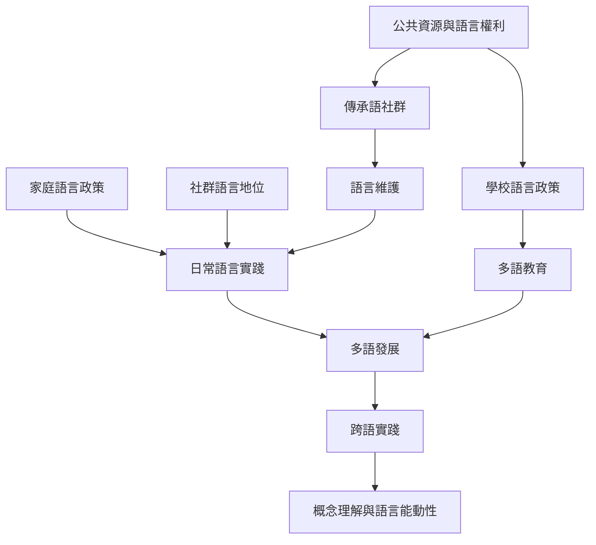

多語發展存在於家庭、學校與社群的語言實踐之中。語言使用的價值、機會與制度資源，會影響孩子接觸哪些語言、在哪些情境使用，以及如何維持傳承語和發展新的語言能力。

## 概念連結
[[多語發展]]、[[跨語實踐]]、[[家庭語言政策]]、[[傳承語]]、[[語言社會化]]、[[多語教育]]、[[語言權利]]。

## 參考
- [[家庭語言政策研究已從語言維持擴展到兒童能動性與科技媒介]]
- [[多語教育應以學習者理解的家庭語言作為重要教學資源]]
- [[多語不是兩套互斥系統而是可互相支援的溝通資源]]

本書導讀：[[Language_development]]。
