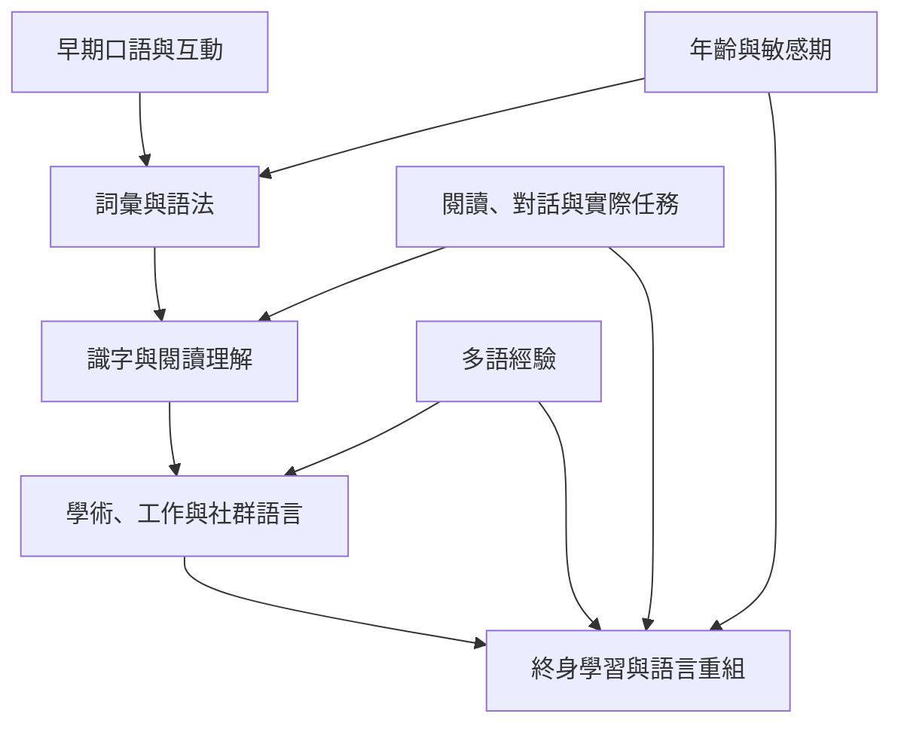

語言發展並不在幼兒期結束。兒童的口語能力為識字奠基，學校與社群持續擴展敘事、學術與專業語言；成人也能透過學習與使用改變語言網絡。年齡效應會因語言面向與學習條件而異，不能將敏感期誤解成學習終止。

## 概念連結
[[詞彙發展]]、[[句法發展]]、[[識字發展]]、[[敘事能力]]、[[敏感期]]、[[成人語言學習]]、[[神經可塑性]]。

## 參考
- [[學齡前詞彙與語法能力共同預測早期閱讀表現]]
- [[大型語法學習研究支持青春期後能力下降但不等於成人無法學習]]
- [[成人第二語言學習仍伴隨可測量的神經可塑性變化]]

本書導讀：[[Language_development]]。
