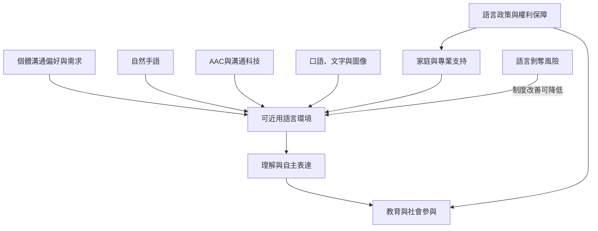

語言公平的核心不是要求每個人以相同方式說話，而是確保每個人及早取得完整、可理解且可表達的溝通系統。手語、AAC、口語與文字都可以是個體參與生活的資源；制度若延遲或拒絕提供可近用語言，會將差異轉化為剝奪。

## 概念連結
[[手語習得]]、[[語言剝奪]]、[[輔助與替代溝通]]、[[發展性語言障礙]]、[[語言可近用性]]、[[神經多樣性]]。

## 參考
- [[自然手語在早期可近用輸入下依循完整語言發展路徑]]
- [[輔助與替代溝通能為少口語自閉症幼兒提供溝通管道]]
- [[CATALISE共識將發展性語言障礙與已知病因相關語言障礙加以區分]]

本書導讀：[[Language_development]]。
