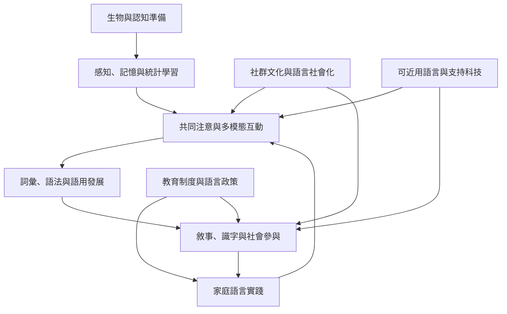

語言發展可視為多層次的動態生態系統：個體的感知與學習機制，透過互動與語言輸入，連結到家庭、社群、教育制度與語言政策。各層彼此影響，沒有任何單一變項足以完整解釋發展差異。

## 概念連結
- 個體機制：[[統計學習]]、[[語音發展]]、[[詞彙發展]]、[[句法發展]]。
- 互動過程：[[共同注意]]、[[手勢溝通]]、[[回應式互動]]、[[語言輸入]]。
- 社會脈絡：[[語言社會化]]、[[家庭語言政策]]、[[多語教育]]、[[傳承語]]。
- 公平與可近用：[[手語習得]]、[[語言剝奪]]、[[輔助與替代溝通]]。

## 參考
- [[語言發展是個體與互動環境共同形成的動態歷程]]
- [[語言能力具有共通基礎但兒童的發展路徑並不完全相同]]
- [[語言發展]]、[[語言社會化]]。

本書導讀：[[Language_development]]。
