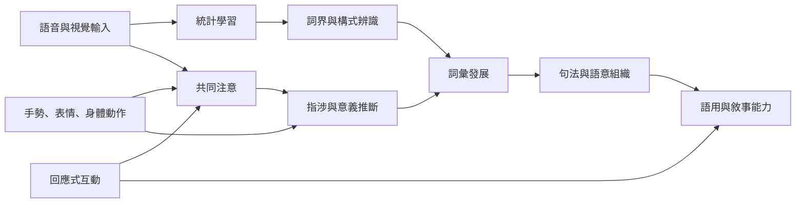

語言習得不是單一機制。學習者從語音流中抽取規律，利用共同注意與互動推斷意義，將具體語句逐步組織成詞彙與語法知識，再將語言用於敘事、閱讀與社會參與。

## 概念連結
[[統計學習]]、[[共同注意]]、[[手勢溝通]]、[[語音發展]]、[[詞彙發展]]、[[句法發展]]、[[語用發展]]、[[敘事能力]]、[[回應式互動]]。

## 參考
- [[嬰兒能利用語音統計規律推測連續語流中的詞界]]
- [[幼兒手勢能預測後續詞彙與句子能力的不同面向]]
- [[語言學習同時依賴模式辨識與社會互動]]

本書導讀：[[Language_development]]。
