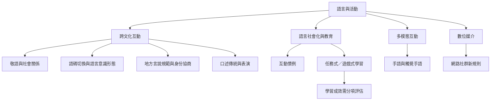

語言遊戲的分析可延伸到多語社會、語言社會化、敬語、手語、跨文化翻譯與遊戲式教育，但延伸時必須標示理論邊界。語言遊戲是哲學概念；溝通民族誌、社會語言學、會話分析與教育統合分析則是各自有研究問題和方法的領域。它們能互相啟發，卻不能彼此取代。

比較案例時，應記錄具體參與者、場域、媒介、研究方法與樣本邊界。台灣語言轉移研究不可代表所有台灣家庭；日本敬語研究不可代表所有日本互動；觸覺Auslan單一案例也不能推廣到所有手語社群。

## 概念延伸
* [[語言社會化]]、[[溝通民族誌]]、[[溝通能力]]、[[語碼轉換]]、[[語言意識形態]]、[[手語互動]]、[[遊戲式語言學習]]
* [[跨文化溝通必須理解互動規範而不只翻譯字詞]]、[[語言遊戲可以透過聲音以外的感官模式完成]]、[[外語學習需要練習參與情境而不只背誦句型]]
* 全球案例：[[台灣閩南語世代轉移顯示語言選擇與親密關係及公共領域相連]]、[[日本敬語的歷史變化顯示語法形式會索引社會關係]]、[[澳洲觸覺手語對話顯示輪替規則不依賴聲音媒介]]、[[布隆迪的言說民族誌顯示修辭方式與社會位置相連]]、[[非洲與加勒比海口述傳統以表演承載社群記憶]]、[[哥倫比亞西北亞馬遜的語碼混用挑戰單語規範]]、[[智利多語社群透過語碼轉換協商身份與歸屬]]、[[行動遊戲語言學習的統合分析支持其效益但不代表所有能力都同等提升]]
