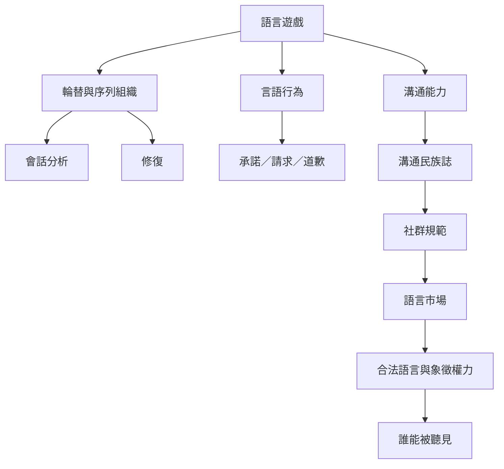

語言遊戲的規則會在互動中展現：誰接續發言、如何理解請求、怎樣修復誤解、誰有權命名或定義問題。但互動規則並非中立；語言形式可能依說話者身份與制度場域而獲得不同價值。從會話分析到布迪厄的語言市場，可以看到語言同時是協作媒介與權力場域。

本圖把不同學科放在互相照明的位置，而非宣稱它們是同一理論。Sacks 等人的會話分析描寫輪替機制；Austin 的言語行為理論分析說話完成的行動；Hymes 的溝通民族誌關注社群溝通規範；Bourdieu 則使權力和合法性進入分析。

## 概念延伸
* [[會話分析]]、[[輪替]]、[[修復]]、[[言語行為]]、[[溝通民族誌]]、[[溝通能力]]
* [[語言市場]]、[[語言意識形態]]、[[語碼轉換]]
* 相關永久筆記：[[互動秩序是在輪流發言與修復中被共同維持]]、[[語言權力會影響誰的說法被視為合理]]、[[語言市場把表達方式轉換成社會價值]]
* 研究來源：[[會話分析揭示對話秩序由參與者即時協調而成]]、[[布迪厄的語言實踐研究揭示合法語言背後的象徵權力]]
