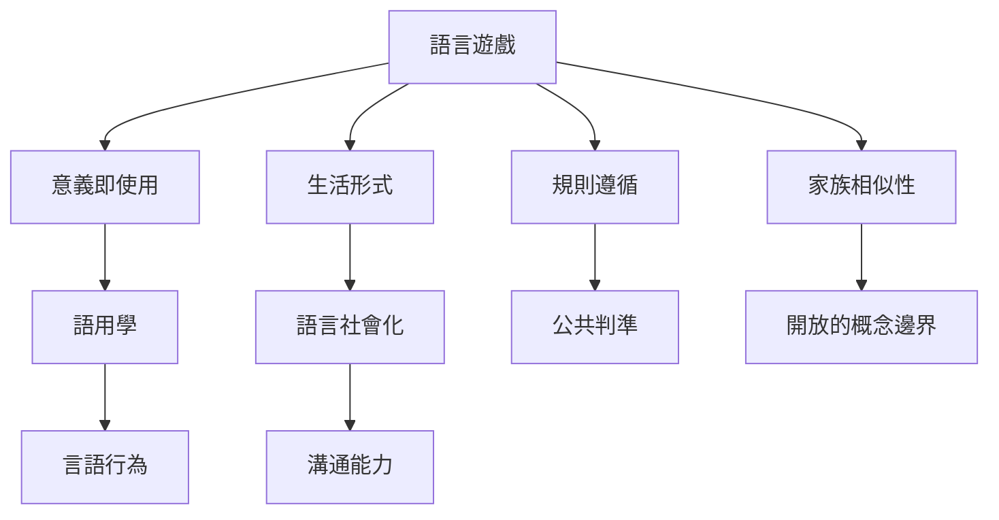

語言遊戲的哲學核心，是把語言從抽象符號系統帶回人們實際共同生活的活動。意義、規則和判斷不是被某個孤立心靈單獨持有，而是在教學、協作、回應、修正與共同實踐中發揮作用。這條概念線索由「意義即使用」連到生活形式、家族相似性和規則遵循。

閱讀本圖時，先從[[意義必須放回實際使用才能理解]]進入，再讀[[語言遊戲由活動和生活形式共同構成]]，接著比較[[家族相似性讓概念的邊界保持開放]]與[[規則遵循需要公共判準而非私人直覺]]。這些概念共同說明語言如何在活動中獲得意義，但不應被誤讀成每種使用都有完全明確的規則。

## 概念延伸
* [[語言遊戲]]、[[意義即使用]]、[[生活形式]]、[[家族相似性]]、[[規則遵循]]
* [[語用學]]、[[言語行為]]、[[語言社會化]]、[[溝通能力]]
* 原典與研究：[[維根斯坦以語言遊戲指出說話總是嵌入活動之中]]、[[史丹佛哲學百科將語言遊戲連結到家族相似性與生活形式]]、[[中文研究從語言遊戲與生活形式的關係解讀維根斯坦後期哲學]]
