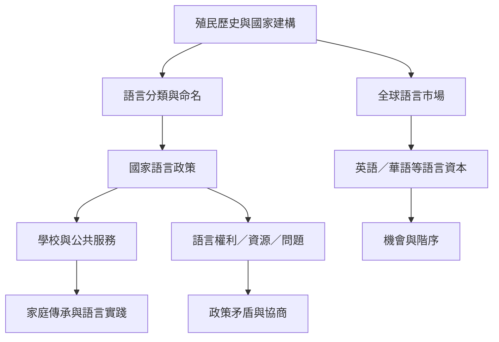

國家語言制度不是歷史之外的中性安排。殖民分類、民族國家建構、教育政策與全球市場共同決定哪些語言能獲得官方地位、公共資源與經濟價值。台灣、非洲、印度與新加坡案例可互相比較，但不可抹平各地歷史差異。

概念連結：[[Language_policy]]、[[Language_rights]]、[[Linguistic_capital]]、[[Language_ideology]]、[[Language_revival]]

## 參考
* 全書導讀：[[Language_ideology]]。

延伸概念地圖：[[標準化與社會階序的概念地圖]]、[[語言媒介技術與不平等的概念地圖]]、[[語言意識形態的概念地圖]]、[[語言教育與多語實踐的概念地圖]]、[[語言身分與認同的概念地圖]]
