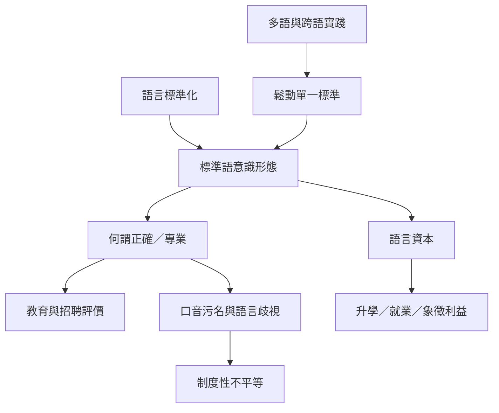

標準化將特定語言形式制度化，並可能把階級、教育與族群差異轉譯為「語言能力」差異。語言資本說明標準形式何以能兌換機會，語言歧視則呈現其排除效果。

概念連結：[[Standard_language_ideology]]、[[Linguistic_capital]]、[[Language_discrimination]]、[[Translanguaging]]、[[Language_ideology]]

## 參考
* 全書導讀：[[Language_ideology]]。

延伸概念地圖：[[國家政策與殖民歷史的概念地圖]]、[[語言媒介技術與不平等的概念地圖]]、[[語言意識形態的概念地圖]]、[[語言教育與多語實踐的概念地圖]]、[[語言身分與認同的概念地圖]]
