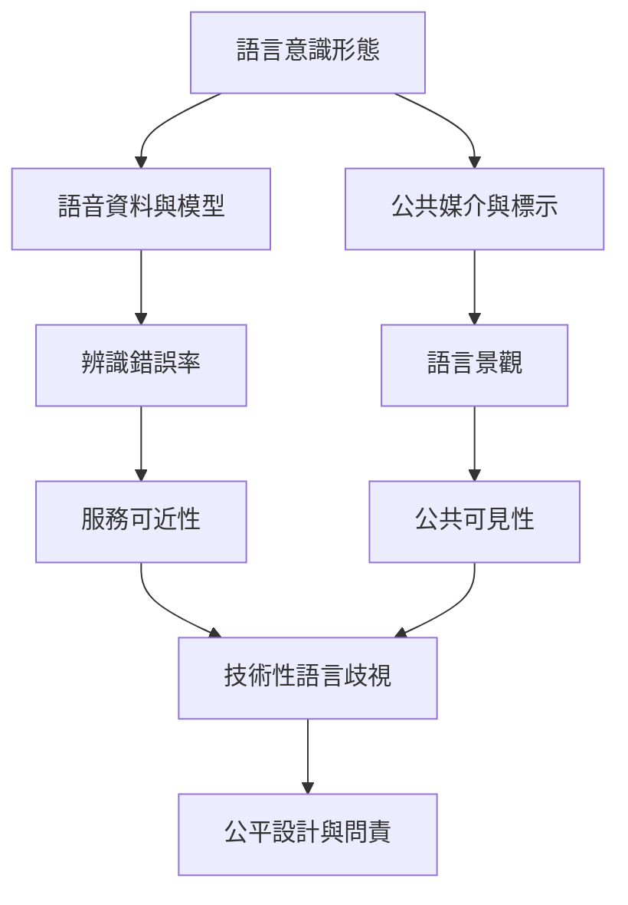

語言不平等會透過媒體、公共標示與數位科技呈現。語言景觀顯示城市如何讓語言可見；語音辨識等技術則把資料選擇與標準語規範寫入模型。兩者都需要以使用者經驗和分群結果檢查。

概念連結：[[Language_ideology]]、[[Linguistic_landscape]]、[[Language_discrimination]]、[[Raciolinguistics]]、[[Language_policy]]

## 參考
* 全書導讀：[[Language_ideology]]。

延伸概念地圖：[[國家政策與殖民歷史的概念地圖]]、[[標準化與社會階序的概念地圖]]、[[語言意識形態的概念地圖]]、[[語言教育與多語實踐的概念地圖]]、[[語言身分與認同的概念地圖]]
