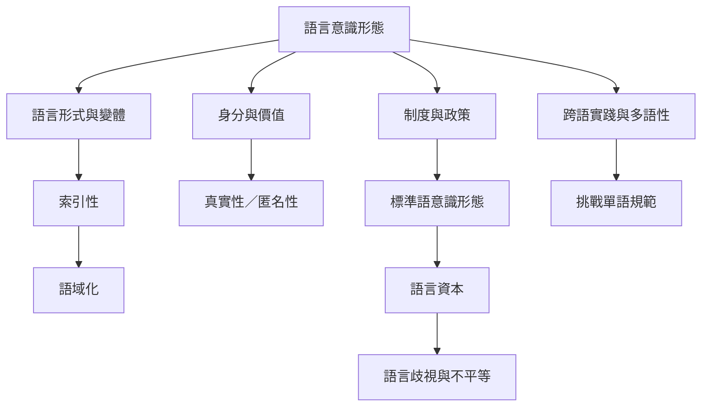

語言意識形態是全書的核心：它連接語言形式、說話者分類、制度與物質後果。分析時先問誰在說、誰在評價、評價依據為何，再追蹤這些評價如何變成政策與資源分配。

概念連結：[[Language_ideology]]、[[Indexicality]]、[[Enregisterment]]、[[Standard_language_ideology]]、[[Linguistic_capital]]、[[Language_discrimination]]、[[Translanguaging]]

## 參考
* 全書導讀：[[Language_ideology]]。

延伸概念地圖：[[國家政策與殖民歷史的概念地圖]]、[[標準化與社會階序的概念地圖]]、[[語言媒介技術與不平等的概念地圖]]、[[語言教育與多語實踐的概念地圖]]、[[語言身分與認同的概念地圖]]
