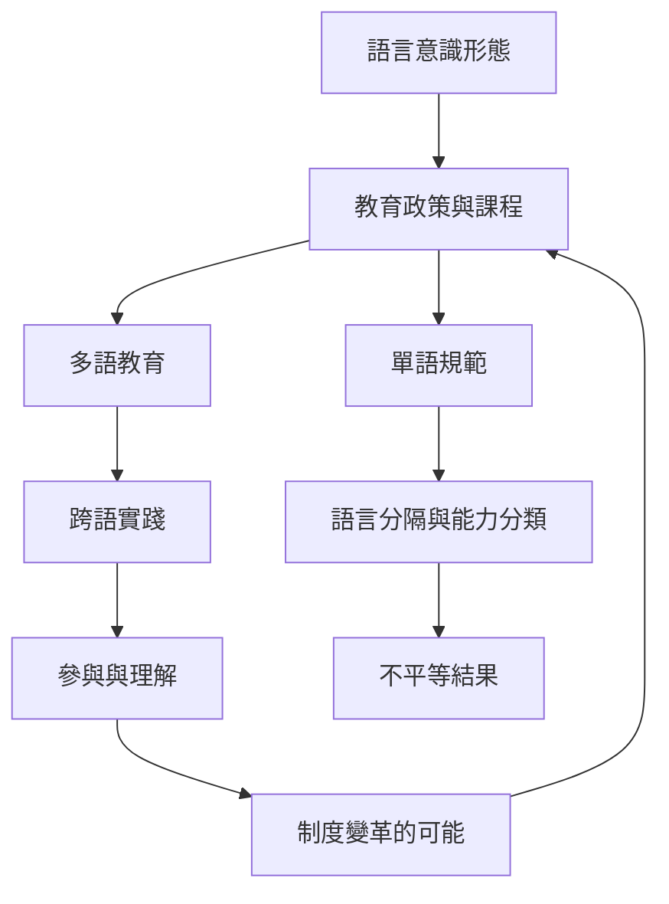

教育制度能再製單語規範，也能讓多語者的整體資源成為學習優勢。分析重點不是簡單宣稱「多語比較好」，而是觀察課程、評量、師資與語言資源如何分配發言權與學習機會。

概念連結：[[Language_ideology]]、[[Language_policy]]、[[Monoglossia]]、[[Heteroglossia]]、[[Translanguaging]]、[[Language_rights]]

## 參考
* 全書導讀：[[Language_ideology]]。

延伸概念地圖：[[國家政策與殖民歷史的概念地圖]]、[[標準化與社會階序的概念地圖]]、[[語言媒介技術與不平等的概念地圖]]、[[語言意識形態的概念地圖]]、[[語言身分與認同的概念地圖]]
