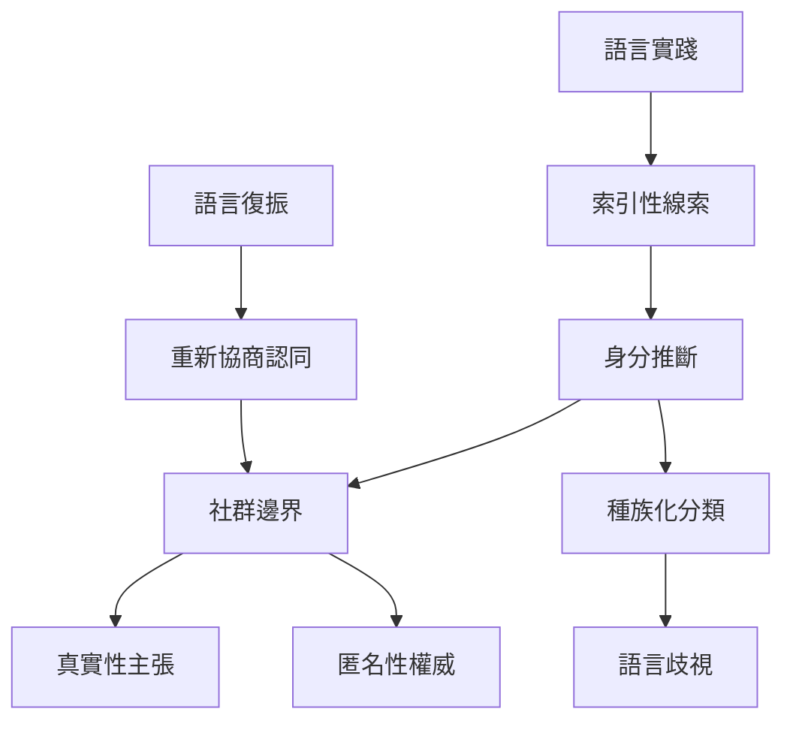

語言不只是表達既有認同，也參與認同的形成。真實性、匿名性、種族化與語言復振，會影響誰被視為社群成員、誰有權代表一種語言，以及新使用者能否取得歸屬。

概念連結：[[Indexicality]]、[[Linguistic_authenticity]]、[[Linguistic_anonymity]]、[[Raciolinguistics]]、[[Language_revival]]、[[Language_discrimination]]

## 參考
* 全書導讀：[[Language_ideology]]。

延伸概念地圖：[[國家政策與殖民歷史的概念地圖]]、[[標準化與社會階序的概念地圖]]、[[語言媒介技術與不平等的概念地圖]]、[[語言意識形態的概念地圖]]、[[語言教育與多語實踐的概念地圖]]
