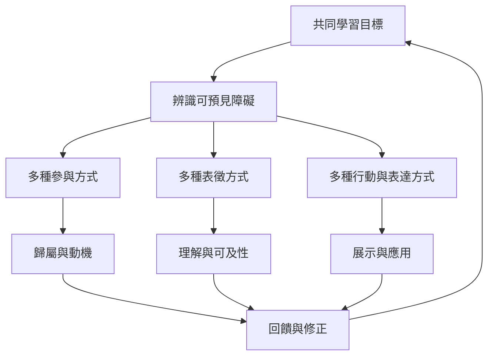

此地圖聚焦如何在不固定分類學生的前提下，讓更多人能參與、理解、行動與表達。設計者應同時檢視多模態表徵、認知負荷、制度性障礙與共同學習文化。

概念：[[通用學習設計]]、[[多模態學習]]、[[文化回應教學]]、[[認知負荷]]、[[先備知識]]。

研究依據：[[通用學習設計以移除障礙而非標記學生]]、[[學習者文化與脈絡是學習科學不可忽略的條件]]、[[家庭知識資源能連接家庭生活與課堂學習]]。

綜合見解：[[多模態教學是可及性設計不是風格配對]]、[[通用設計應預先提供多種進入與表達方式]]、[[公平的學習設計要同時看個人障礙與制度障礙]]。
