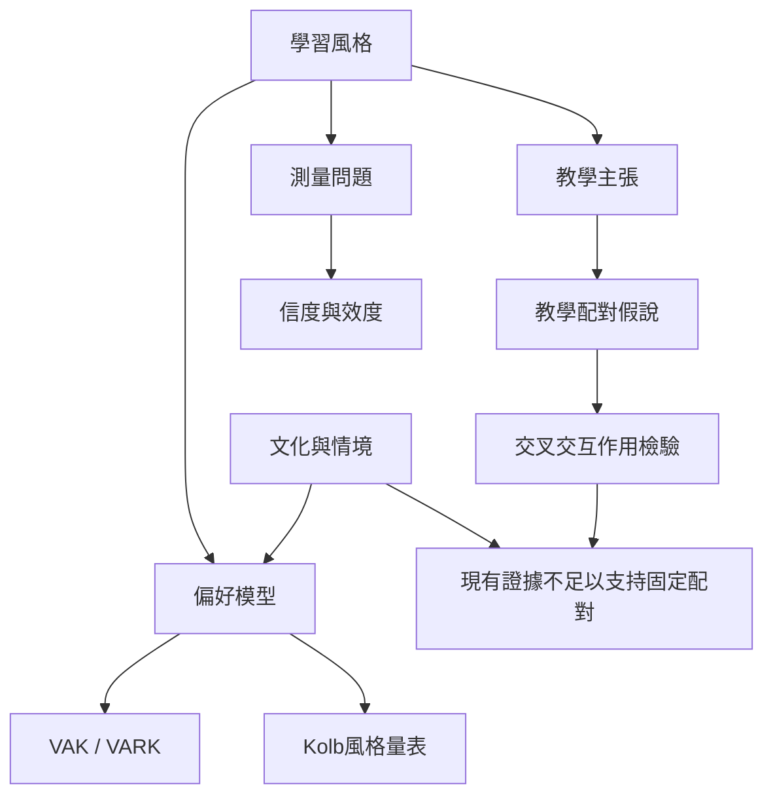

這張地圖整理學習風格模型的不同層次、主要量表與實證限制。閱讀順序建議先釐清 [[學習風格]] 與 [[學習偏好]]，再看 [[VAK]]、[[VARK]]、[[Kolb經驗學習循環]]，最後回到 [[教學配對假說]] 的證據門檻。

核心筆記：[[偏好不是能力也不是固定身份]]、[[教學配對假說需要交叉交互作用而不是個案印象]]、[[分類工具的信度不能替代教學效度]]、[[多模態教學是可及性設計不是風格配對]]、[[學習風格話語的吸引力來自個人化承諾]]、[[認知科學家以問答釐清教學風格配對的界線]]。

研究來源：[[學習風格分類缺乏足夠證據支持教學配對]]、[[學習風格模型需要逐一評估而不能一概而論]]、[[視覺聽覺動覺配對假說未通過嚴格檢驗]]、[[學習風格神經迷思為何在高等教育持續流傳]]、[[VARK量表可量測偏好但不等同教學成效]]、[[Kolb學習風格量表的信效度爭議需要納入解讀]]、[[全球數學教育的VARK研究仍缺乏一致證據]]、[[2026概念分析再次指出感官風格配對缺乏可靠基礎]]。
