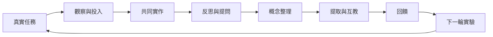

這張地圖將個人學習策略與社群行動連起來，提供讀書會、工作坊與生活技能學習的實作架構。完整循環包含真實任務、觀察與投入、反思、概念化、提取、回饋與下一輪實驗。

可連結的理論：[[Kolb經驗學習循環]]、[[觀察與投入式學習]]、[[對話式教育]]、[[自我調節學習]]、[[提取練習]]、[[學習遷移]]。

可行動筆記：[[把生活中的共同勞動設計成學習課程]]、[[用學習夥伴輪流教學與回饋]]、[[為愛洋洋讀書會設計學會學習實驗]]、[[以一週提取紀錄檢驗真正記得什麼]]、[[設計個人學習儀表板觀察策略與保留而非風格]]。
