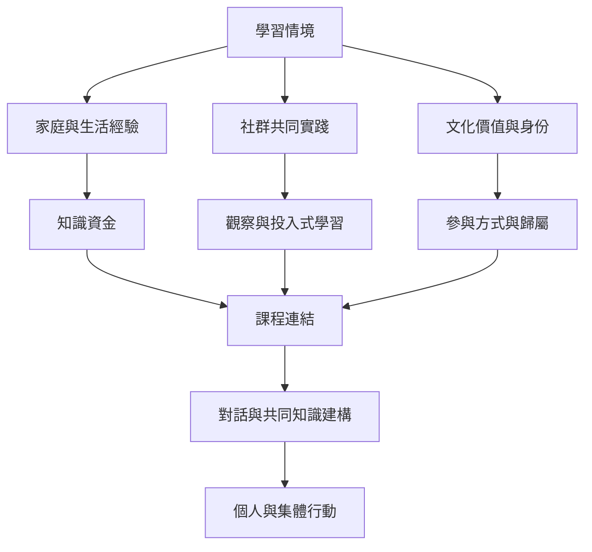

此地圖將學習放回家庭、文化、社群與共同實踐。它不主張某個國家或族群有固定學習風格，而是追問學習機會如何由語言、社會關係、日常勞動、身份與權力共同構成。

概念：[[文化回應教學]]、[[知識資金]]、[[觀察與投入式學習]]、[[對話式教育]]、[[Ubuntu教育哲學]]。

研究與觀點：[[跨國研究顯示文化價值與學習偏好存在關聯]]、[[學習者文化與脈絡是學習科學不可忽略的條件]]、[[原住民與社群學習可透過觀察參與共同勞動]]、[[家庭知識資源能連接家庭生活與課堂學習]]、[[Ubuntu教育哲學將互賴與共同責任納入學習]]、[[Freire對話教育使學習者成為知識共同創造者]]、[[Freire訪談將批判思考與社會情境帶入教育]]、[[Barbara_Rogoff訪談把學習放回社群參與與年齡關係]]。
