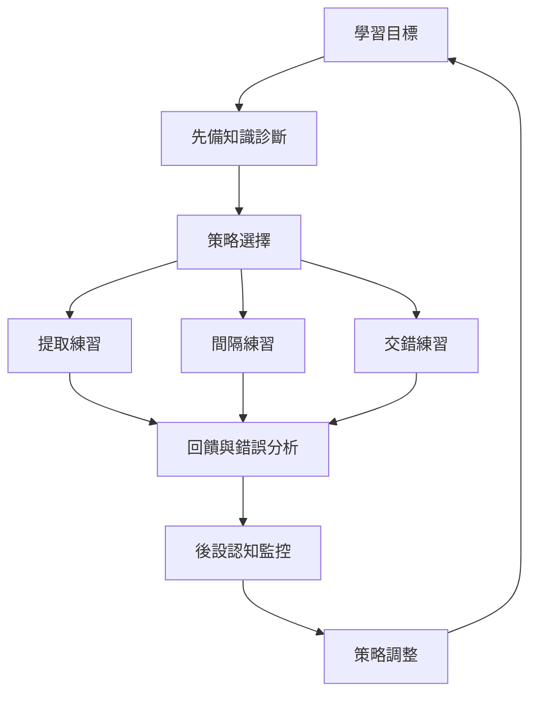

這張地圖從固定風格分類轉向可訓練的策略與調節能力。核心問題不是「我是什麼型」，而是「面對這個目標，哪種練習能產生可保留、可提取、可遷移的成果」。

核心概念：[[自我調節學習]]、[[後設認知]]、[[提取練習]]、[[間隔練習]]、[[交錯練習]]、[[先備知識]]、[[學習遷移]]、[[認知負荷]]。

研究依據：[[提取練習讓記憶測驗同時成為學習活動]]、[[分散練習的間隔應配合預計保留時間]]、[[多種學習策略的效益存在明顯差異]]、[[自我調節學習研究提醒我們熟悉感可能造成錯覺]]、[[中國大學生語言學習中策略使用比固定類型更值得追蹤]]。
