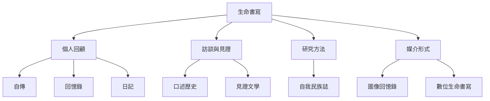

生命書寫的形式可以依敘述者、媒介、時間尺度、受眾與社會用途分類；但分類是閱讀工具，不是固定邊界。自傳與回憶錄通常由本人回顧生活，日記記錄當下片段，口述歷史透過訪談形成共同材料，見證文學將個人經驗連結集體歷史，自我民族誌將個人經驗轉化為文化分析，數位生命書寫則將敘事擴展到平台與網絡。

參照[[term/生命書寫是跨文類的生命再現實踐]]、[[term/自傳以作者自身人生為主要敘述對象]]、[[term/回憶錄選取人生片段或主題進行回顧]]、[[term/口述歷史透過訪談保存個人與集體記憶]]、[[term/見證文學把個人證言連結到集體歷史]]、[[term/自我民族誌以個人經驗分析文化脈絡]]與[[term/數位生命書寫透過平台與網絡呈現持續中的自我]]。

[[Life_writing]]
