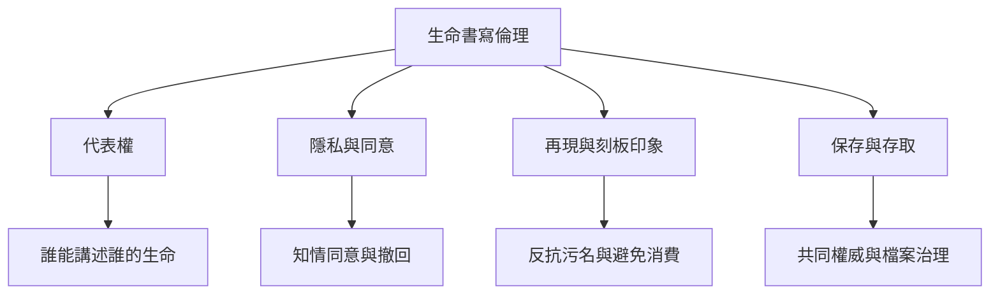

生命敘事的生產、保存與傳播從來不只是技術問題。作者、受訪者、編輯、翻譯者、檔案館、出版市場與平台之間存在權力差異。生命書寫可以抵抗歷史沉默與污名，也可能挪用他人故事、重複刻板印象或暴露私人資訊。倫理需要貫穿研究、寫作、編輯、公開與再利用的每一步。

參照[[term/知情同意是參與者理解用途與風險後的持續選擇]]、[[term/共同權威讓敘述者參與歷史材料的決策]]、[[note/書寫他人生命必須處理同意隱私與權力差異]]、[[note/身體經驗能揭露制度如何塑造生命]]與[[data/口述歷史需要知情同意共同決策與可持續保存]]。

[[Life_writing]]
