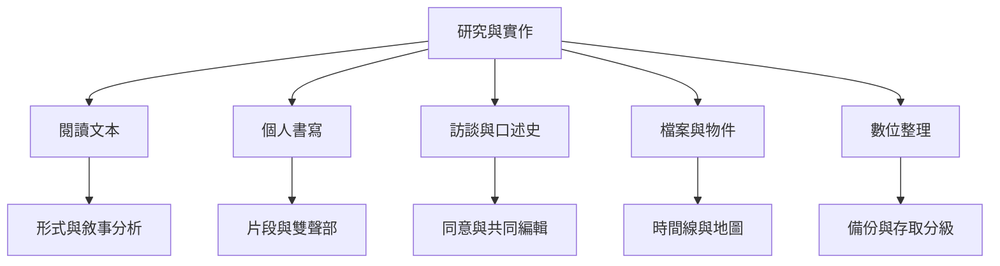

生命書寫研究可以從文本閱讀、個人日常記錄、口述訪談、自我民族誌、檔案研究與數位足跡整理展開。實作上，關鍵不是追求完整傳記，而是建立可追溯、可修訂、尊重敘述者的材料流程，並將個人經驗與文化脈絡連接。

參照[[term/自我民族誌以個人經驗分析文化脈絡]]、[[term/口述歷史透過訪談保存個人與集體記憶]]、[[idea/每週記錄一個普通片段比等待人生大事更能累積生命史]]、[[idea/把個人年表與社會年表疊合能看見制度如何進入生命]]、[[idea/用持續同意與共同編輯設計安全的生命訪談]]與[[idea/把數位足跡整理成可選擇公開的生命檔案]]。

[[Life_writing]]
