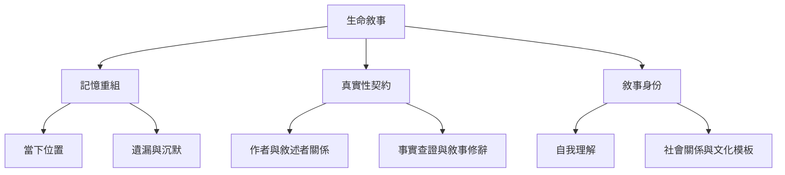

生命書寫既是對過去的回顧，也是身份持續形成的實踐。回憶受到當下位置影響；作者與讀者透過自傳契約協商真實性；敘事身份則在個人講述、社會規範與關係互動中逐步形成。故分析生命敘事時，需要同時辨認可查證事實、記憶、重構與修辭。

參照[[term/自傳契約約定作者敘述者與主角的身份關係]]、[[term/敘事身份由個人與社會互動形成]]、[[note/回憶是現在對過去的重組而非原樣回放]]、[[note/生命故事不只描述身份也參與生成身份]]、[[note/沉默與遺漏也是生命敘事的一部分]]與[[note/生命書寫需要清楚標示回憶事實與推測的差別]]。

[[Life_writing]]
