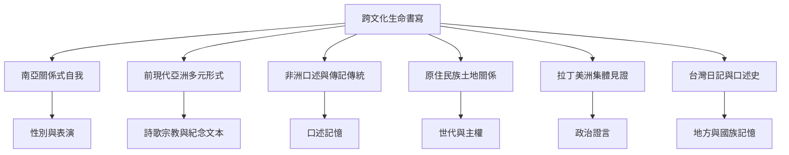

跨文化生命書寫研究的核心不是尋找一套通用的自傳定義，而是比較不同文化如何敘述生命、授權敘述、保存記憶與理解個體。南亞女性自我書寫、前現代亞洲文本、非洲口述傳統、美洲原住民族生命敘事、拉丁美洲 testimonio 與台灣口述史，呈現個人與社群、土地、宗教、性別及歷史的不同關係。

參照[[note/自我敘述始終在關係中生成而非孤立完成]]、[[note/生命書寫的比較研究必須避免把西方自我當成普遍標準]]、[[data/南亞女性自傳顯示自我可以透過關係與表演形成]]、[[data/前現代亞洲自我書寫需要超越西方自傳的狹義定義]]、[[data/非洲生命傳記包含口述傳統與殖民前的自我敘事]]與[[data/美洲原住民族生命書寫把自我與土地及族群未來連結]]。

[[Life_writing]]
