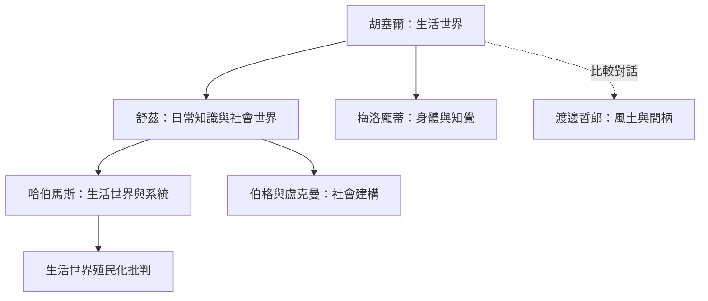

從胡塞爾的先驗現象學出發，生活世界概念經舒茲進入社會現象學，再由哈伯馬斯轉化為分析社會整合和現代性病理的理論資源。梅洛龐蒂則從活生生的身體深化經驗面向；日本風土思想可作為比較視角，而非直接分支。

概念地圖的閱讀方向：先看核心概念如何被不同學派轉化，再沿著跨學科應用連到具體研究和實踐。相關筆記：[[胡塞爾以生活世界揭示科學知識所依賴的前理論根基]]、[[舒茲與盧克曼將生活世界分析轉化為社會現象學]]、[[哈伯馬斯以生活世界與系統解釋現代社會整合]]、[[梅洛龐蒂以活生生的身體說明人如何居於世界]]、[[渡邊哲郎以風土與間柄補充生活世界的地方性和關係性]]、[[伯格與盧克曼說明日常知識如何建構社會現實]]。
