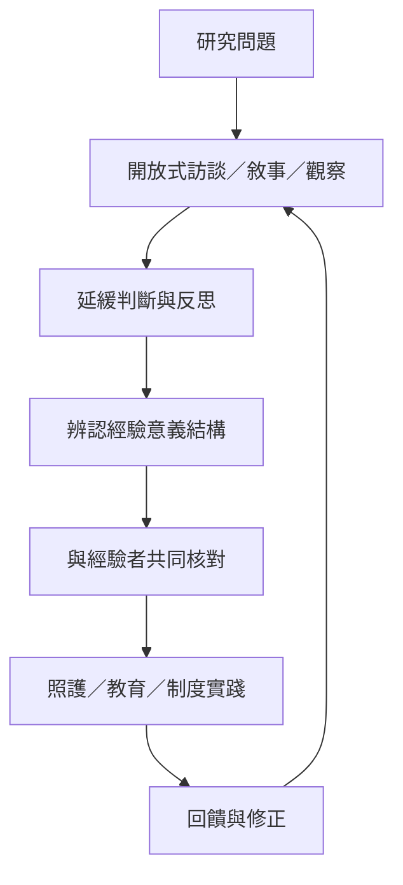

生活世界研究以具體經驗、敘事與觀察為材料，要求研究者保持開放並延緩判斷。照護與教育研究可以把研究成果轉化為更貼近人的生活脈絡的實踐，同時讓經驗者參與問題設定與知識形成。

概念地圖的閱讀方向：先看核心概念如何被不同學派轉化，再沿著跨學科應用連到具體研究和實踐。相關筆記：[[研究者應延緩判斷以保持對經驗的開放]]、[[生活世界導向研究要求經驗者真正參與知識形成]]、[[照護品質必須回應患者生活世界中的重要之事]]、[[范馬能以生活經驗敘事發展教育現象學方法]]、[[用生活世界取向設計一場共同研究工作坊]]。
