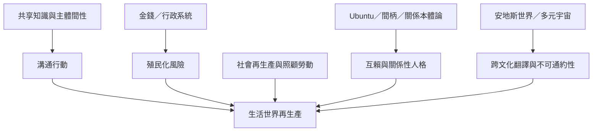

生活世界既由共享知識與溝通行動維持，也可能受到金錢、行政及不平等權力的侵入。女性主義社會再生產、Ubuntu、安地斯原住民世界與多元宇宙視角，使分析不只停留在抽象溝通，也能看見照顧勞動、關係本體論與世界差異。

概念地圖的閱讀方向：先看核心概念如何被不同學派轉化，再沿著跨學科應用連到具體研究和實踐。相關筆記：[[生活世界由共享知識與類型化支撐]]、[[系統殖民化會把溝通關係改寫為工具關係]]、[[生活世界的維持依賴常被忽略的照顧勞動]]、[[跨文化理解需要承認部分不可通約]]、[[人是在關係之間成為人]]。
