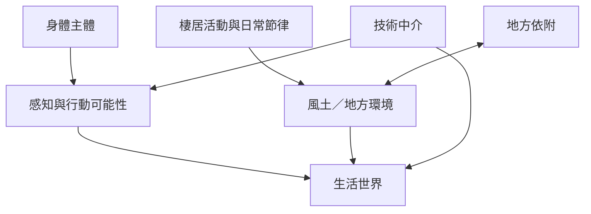

生活世界透過身體感知和實際行動顯現，也受到地方環境、活動節奏與技術中介塑造。這組概念適合用來研究日常移動、居住、感官經驗與數位生活。

概念地圖的閱讀方向：先看核心概念如何被不同學派轉化，再沿著跨學科應用連到具體研究和實踐。相關筆記：[[身體是生活世界的感知座標]]、[[地方不是背景而是持續實踐的成果]]、[[技術中介會重新安排生活世界中的可見與可行]]、[[用一段熟悉的步行路線製作生活世界感官地圖]]。
