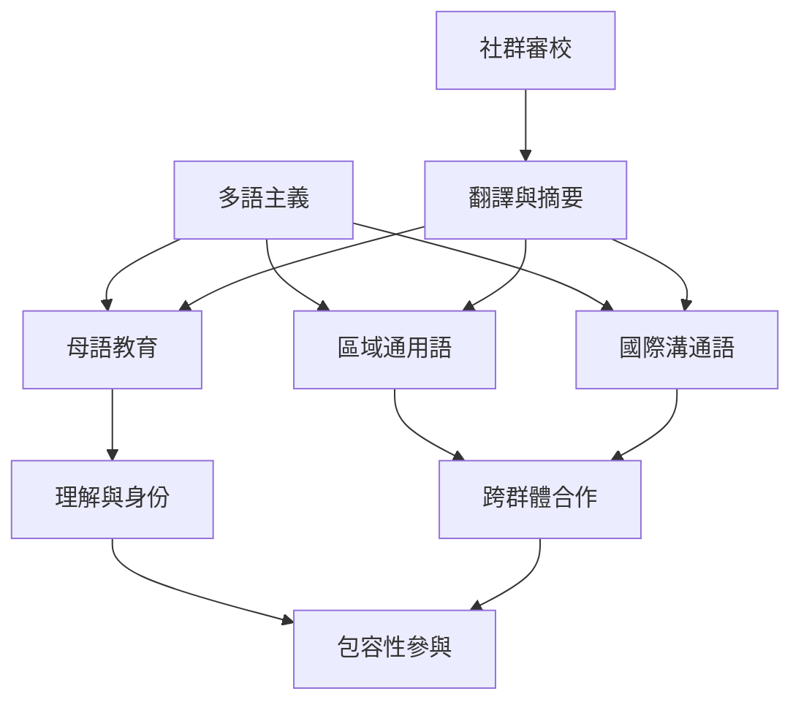

多語主義不是要求每個人精通所有語言，而是建立能讓不同語言資源被使用、理解與維護的制度。教育與社群活動可以讓共同語能力和母語／地方語言互補，並把翻譯、摘要、術語對照及多語主持視為共同基礎設施。

* [[通用語與母語教育可以互補而不是互相排斥]]
* [[區域通用語能促進功能合作卻不必然創造共同身份]]
* [[語言技術可以降低理解成本但不能取代語言權利制度]]
* 相關概念：[[Multilingualism]]、[[Translanguaging]]、[[Language ecology]]、[[International auxiliary language]]。
