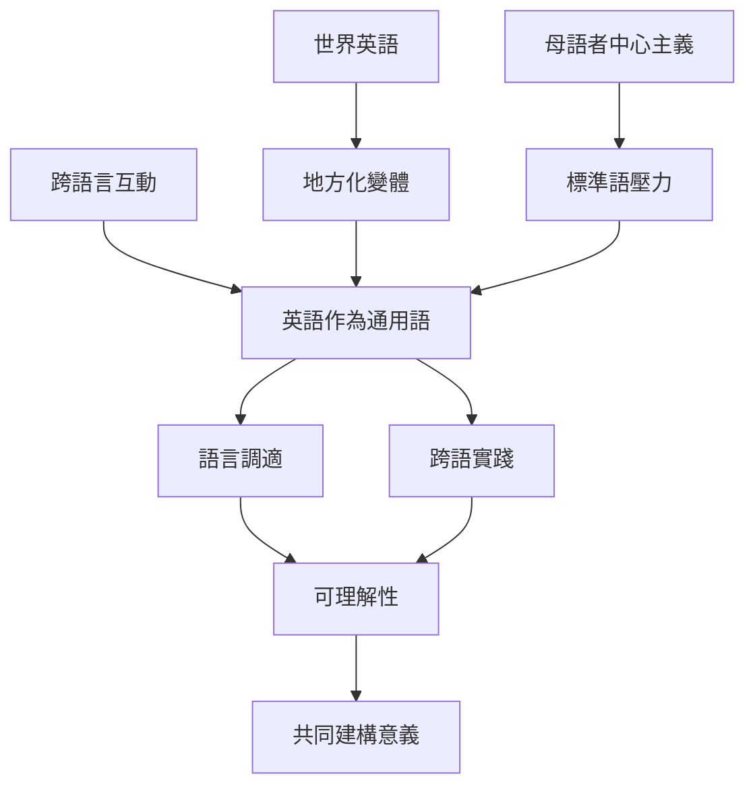

ELF 的核心不是尋找一種固定的全球英語，而是研究多語者如何在特定互動中使用英語與其他資源建立理解。它與 World Englishes 有交集，但分別強調互動實踐和地方變體社會史。

* [[英語作為通用語是多語使用者共同協商的實踐]]
* [[溝通成功應以共同理解而非模仿母語者口音作為主要尺度]]
* [[世界英語觀點承認英語已發展出多種地方化形式]]
* 相關概念：[[English as a lingua franca]]、[[World Englishes]]、[[Translanguaging]]、[[Intelligibility]]、[[Accommodation (linguistics)]]。
