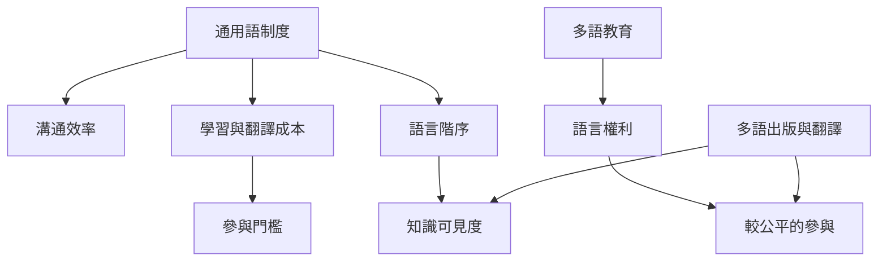

通用語同時是溝通工具與資源分配機制。誰能負擔學習、誰的語言被視為正統、誰的研究和地方知識能被看見，都會改變共同語的實際效果。語言公平需要多語教育、翻譯支持與制度責任。

* [[共同語能降低跨群體溝通成本卻也可能製造新的參與門檻]]
* [[通用語的政治中立性必須從不同語言社群的位置檢驗]]
* [[語言公平需要重新分配翻譯與學習成本]]
* [[英語主導科學發表會擴大語言與經濟差距]]
* [[多語教育應保障學習者以理解的語言學習的權利]]
* 相關概念：[[Linguistic imperialism]]、[[Language ideology]]、[[Linguistic rights]]、[[Language policy]]。
