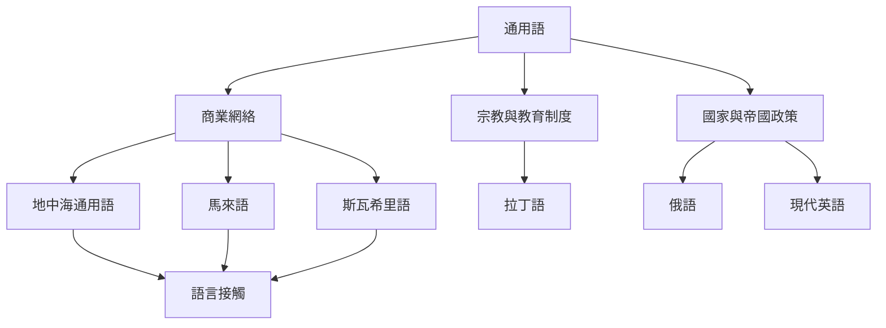

通用語的歷史不是一條單一語言取代另一種語言的直線，而是不同地區的商業網絡、宗教機構、教育制度與國家權力，反覆創造跨語言溝通需求。地中海、東非、東南亞與中世紀歐洲呈現不同形成路徑。

* [[通用語是一種跨語言群體的功能而不是固定的語言類型]]
* [[通用語的擴張通常依賴交通網絡與制度性支持共同作用]]
* [[通用語的歷史應以多中心網絡而非單一語言接替敘事理解]]
* 案例：[[地中海通用語是多語港口社會形成的口語接觸語]]、[[斯瓦希里語的區域通用功能根植於東非沿岸與印度洋互動]]、[[15至17世紀馬來語因港口網絡成為東南亞貿易通用語]]、[[拉丁語曾支撐中世紀歐洲學術跨地域交流]]。
