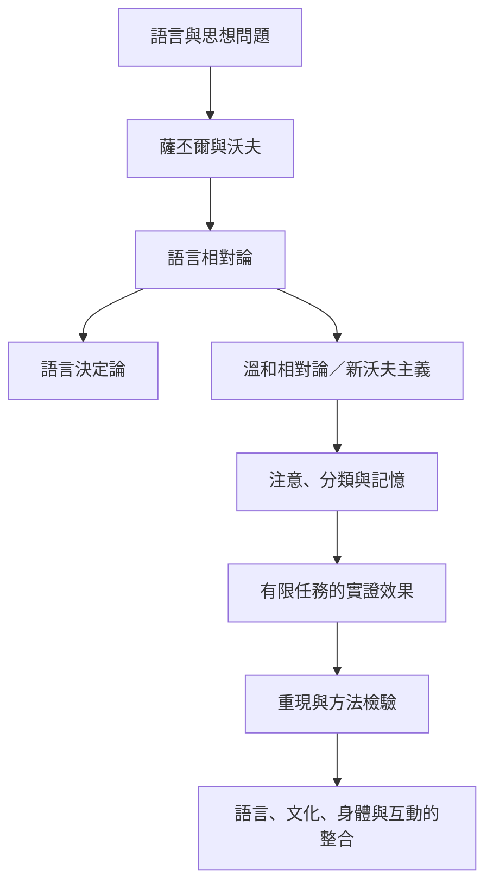

整理語言相對論從思想史到當代實證研究的主要路徑。核心不是判定整體理論真或假，而是區分理論強度、研究單位與因果機制。

## 閱讀入口
* [[語言是文化實踐而不只是思想的標籤——薩丕爾《語言》提供的起點]]
* [[沃夫的論點應回到原文與語言資料中檢驗——《語言思想與現實》]]
* [[語言相對論不是語言決定論]]
* [[語言相對論是一組可分開檢驗的假說]]

## 思與行
* 維護此圖時，同步更新對應文獻與永久筆記。
* 每個案例都保留研究任務與限制，避免過度概括。

---

知識庫導讀：[[Linguistic_relativity]]
