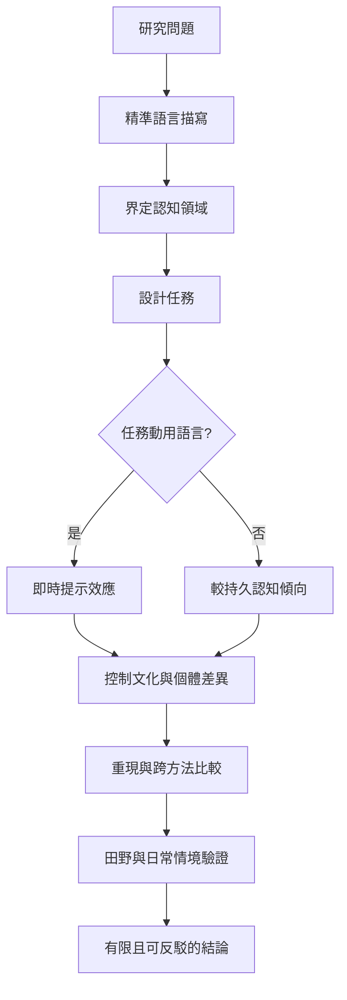

研究語言與思想的關係，需要掌握語言描寫、認知任務、樣本背景、因果推論與生態效度。案例可以啟發問題，但不足以證明群體具有固定世界觀。

## 閱讀入口
* [[語言相對論研究必須先做好語言描寫]]
* [[跨文化研究要避免把文化差異當成語言效果]]
* [[語言相對論研究必須區分習慣效應與即時提示]]
* [[語言效應需要跨任務重現才足以支持強結論]]
* [[當代語言相對論需要結合實驗與自然情境研究——具身取向回顧]]

## 思與行
* 維護此圖時，同步更新對應文獻與永久筆記。
* 每個案例都保留研究任務與限制，避免過度概括。

---

知識庫導讀：[[Linguistic_relativity]]
