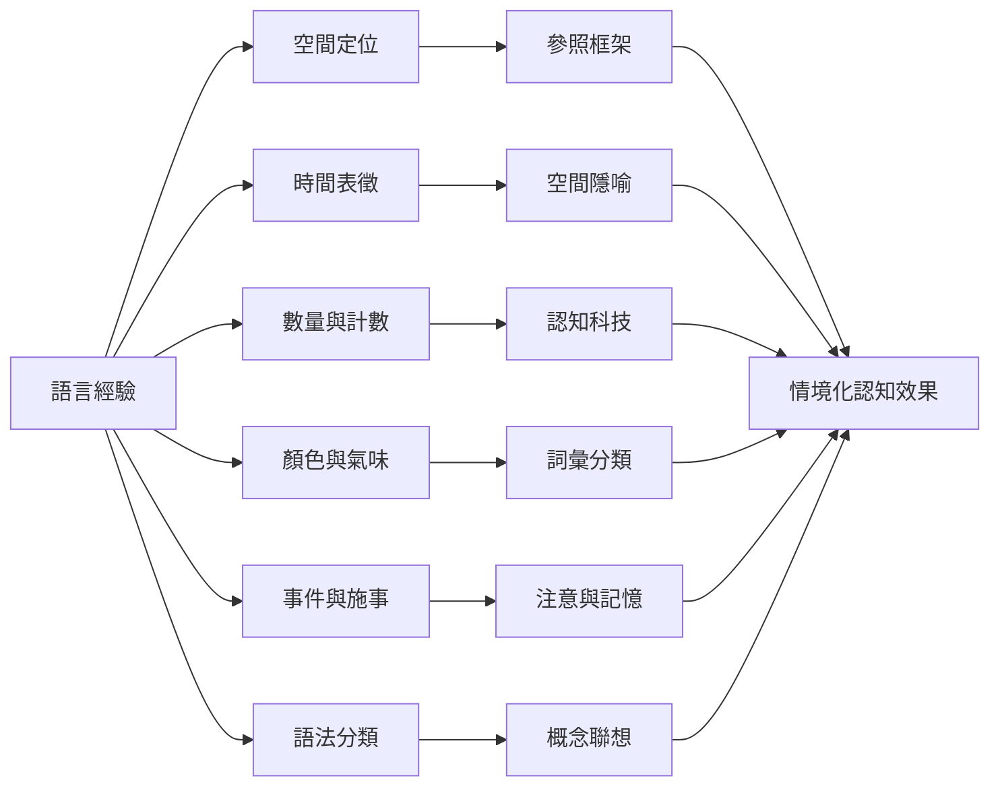

實證研究涉及空間、時間、數量、感官、事件記憶與語法分類。每個領域都需要不同的測量方式，不能用單一案例代表整體理論。

## 閱讀入口
* [[絕對方位詞可能訓練說話者持續追蹤環境方向——Guugu Yimithirr 研究]]
* [[中文與英文的時間隱喻可能影響時間推理但證據並不單純——Boroditsky 研究]]
* [[數詞能作為跨時間保持精確數量的認知科技——Frank 等人的 Pirahã 研究]]
* [[Jahai 語言的氣味詞彙挑戰西方語言普遍難以描述氣味的假設]]
* [[色彩詞彙呈現跨語言共通性與文化差異並存——世界色彩調查]]
* [[事故描述的語法選擇可能改變責任歸因與目擊記憶]]

## 思與行
* 維護此圖時，同步更新對應文獻與永久筆記。
* 每個案例都保留研究任務與限制，避免過度概括。

---

知識庫導讀：[[Linguistic_relativity]]
