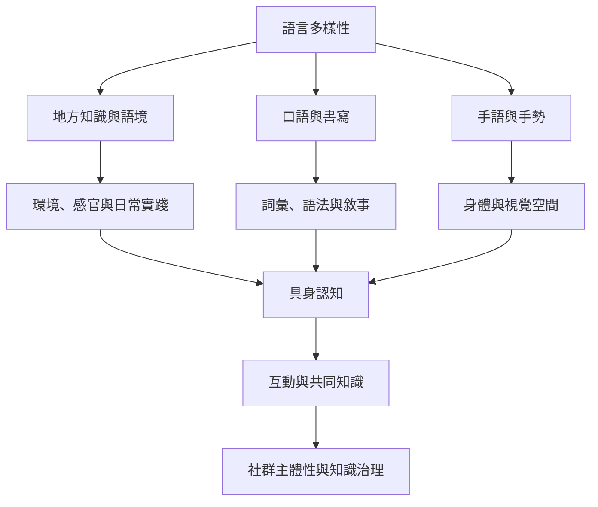

語言存在於詞彙、手勢、身體活動、感官實踐、地景知識與社會互動。研究若只把語言當成個體心理變項，會忽略社群如何使用、維護與改造語言。

## 閱讀入口
* [[跨文化研究必須從地方語彙出發而非預設英語分類]]
* [[語言相對論研究應納入手勢與手語而非只研究口語詞句]]
* [[語言多樣性保存需要社群主體性與長期合作]]
* [[語言相對論研究應把互動情境納入分析]]

## 思與行
* 維護此圖時，同步更新對應文獻與永久筆記。
* 每個案例都保留研究任務與限制，避免過度概括。

---

知識庫導讀：[[Linguistic_relativity]]
