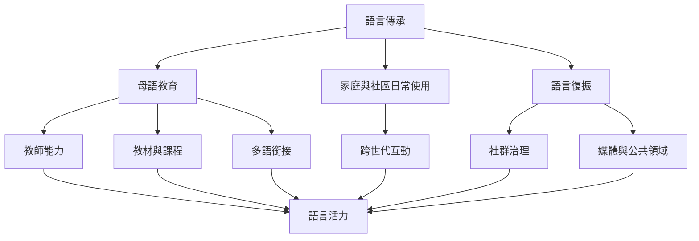

教育是語言傳承的制度場域，但教育政策只有與社群日常使用、師資資源及語言轉移脈絡相連，才能形成長期效果。

核心筆記：[[母語教育是語言傳承的制度條件]]、[[教育語言平等需要可持續的師資與教材投入]]、[[多語教育可以同時支持母語與跨語溝通]]、[[語言復振依賴日常使用與跨世代傳承]]。政策案例可對讀[[UNESCO主張以學習者理解的語言作為多語教育起點]]、[[印度憲法以文化保存與母語初等教育保護語言少數群體]]與[[原住民族語言權包含復振傳承與政治法律程序中的可理解性]]。
