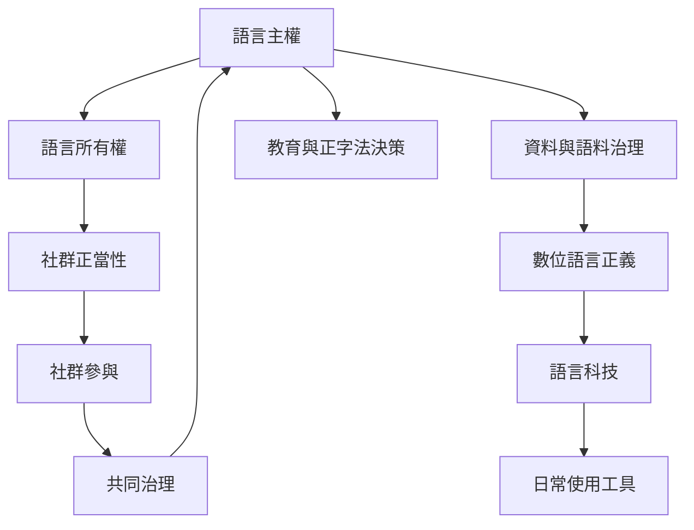

語言復振涉及誰有權決定語言的名稱、教學方式、語料用途、知識公開與科技發展。若缺少社群治理，典藏與數位化也可能重製原有權力關係。共同治理並不排除外部合作，而是要求合作建立在社群的知情同意與實質決策權之上。

## 概念連結
* [[語言主權]]、[[語言所有權]]、[[社群參與]]、[[數位語言正義]]、[[原住民族語言權]]。
* [[語言復振不能把社群縮減成研究資料提供者]]、[[語言主權包含對語料與文化知識的治理權]]、[[數位語言資源應由社群共同治理]]。
* 主要文獻：[[原住民族語言復振的第一人稱敘事把語言重新理解為主體性]]、[[台灣原住民族語言復振訪談顯示語言所有權與合作責任需要協商]]、[[特魯庫語行動社群研究指出數位媒介需要線下關係支撐]]。
