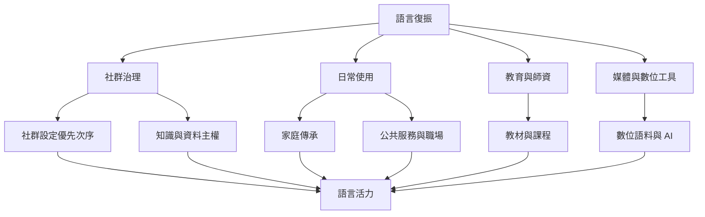

語言復振既是語言教育與使用環境的建構，也是社群重新掌握語言資料、知識與公共決策的過程。技術可提供工具，卻不能代替語言社群的主體性。

進一步思考[[語言復振必須由語言社群參與治理]]、[[語言權不能以集體保存之名取消個人自主]]，並延伸到[[社區語言資料庫應由說話者共同決定資料的使用方式]]、[[地方政府可以建立公開的語言權落實儀表板]]及[[AI翻譯與語音工具應納入語言正義而不只追求涵蓋數量]]。
