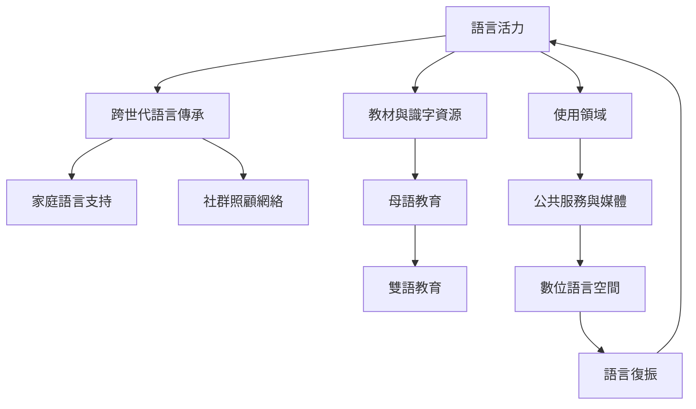

語言能否延續，取決於兒童是否有機會在家庭、學校與社群中實際使用語言，以及教育制度是否提供足夠資源。語言活力評估不能只看總使用人口，還要關注跨世代傳承、使用領域與新媒體環境。

## 概念連結
* [[母語教育]]、[[雙語教育]]、[[語言活力]]、[[語言復振]]、[[跨世代語言傳承]]、[[語言轉移]]。
* [[母語教育應同時保障母語與更廣泛的社會參與]]、[[語言復振必須擴大日常使用領域而非只增加典藏]]、[[家庭語言支持應從增加共同使用機會而非責怪家長開始]]。
* 主要文獻：[[ILO第169號公約要求原住民族教育兼顧母語與社會參與]]、[[UNESCO語言活力框架提醒研究者不能只用使用人口數衡量]]、[[紐西蘭毛利語法制從官方地位走向日常使用策略]]。
