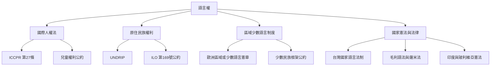

語言權的制度基礎分布於國際人權公約、原住民族權利、兒童權利、區域條約與各國憲法法律。比較時應區分權利主體、國家義務、權利可主張性及實施監督，並避免將官方語言地位直接等同於實質平等。

## 概念連結
* [[語言權]]、[[語言人權]]、[[官方語言]]、[[少數語言]]、[[多語治理]]。
* [[語言權不等於官方語言地位]]、[[語言權需要同時處理個人自由與集體延續]]、[[語言平等需要國家採取積極措施而不只是停止歧視]]。
* 文獻基礎：[[國際人權法將少數群體使用自身語言列為受保障的文化權利]]、[[原住民族語言權涵蓋傳承教育與參與公共程序的能力]]、[[歐洲區域或少數語言憲章把語言保障延伸到公共生活]]。
