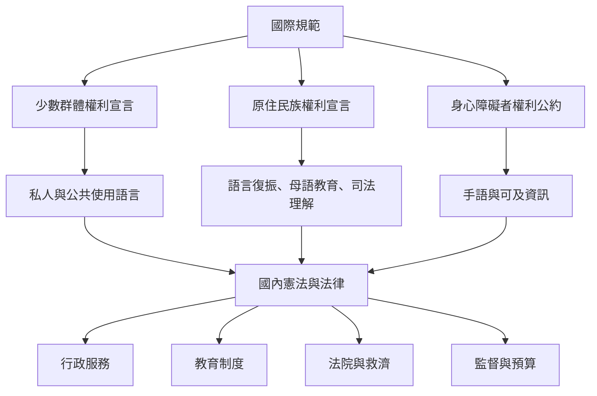

國際人權原則通常需要經國內憲法、專法、公共機構義務及救濟制度具體化。各制度保護的語言種類、適用領域與權利主體不盡相同。

案例可由[[歐洲區域或少數語言憲章把語言保障延伸至公共生活各領域]]開始，再讀[[加拿大憲法以英法少數群體教育權建立具體制度保障]]、[[紐西蘭毛利語法把語言定位為族群珍寶並建立共同治理架構]]、[[台灣國家語言發展法以平等與復振作為語言政策原則]]、[[南非憲法要求提升歷史受壓迫語言地位並公平對待多種語言]]、[[印度憲法以文化保存與母語初等教育保護語言少數群體]]、[[墨西哥法律同時承認原住民族語言權的個人與集體面向]]、[[威爾斯語法以公共機構義務與不低於英語待遇具體化語言權]]及[[挪威薩米法把語言文化發展連結到原住民族自治]]。
