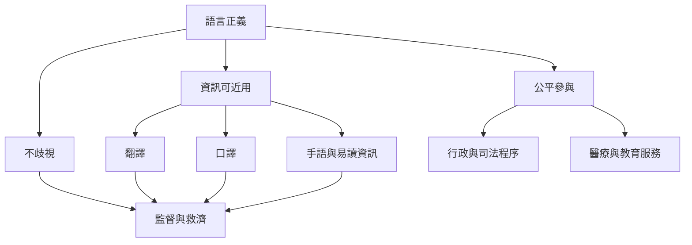

語言正義要求人們能理解公共資訊、表達自身需求並參與制度程序。口譯、翻譯、手語與易讀資訊不是附加便利，而是公共服務的溝通基礎設施。制度設計需要有明確責任、穩定資源、品質標準與申訴機制。

## 概念連結
* [[語言正義]]、[[語言服務]]、[[語言可近用性]]、[[口譯權利]]、[[手語權利]]、[[語言歧視]]。
* [[公共服務語言權必須有可申訴的執行機制]]、[[口譯是實質參與公共服務的基礎設施]]、[[多語公共服務可以從高風險情境建立最低保障標準]]。
* 主要文獻：[[歐洲區域或少數語言憲章把語言保障延伸到公共生活]]、[[移民醫療語言障礙系統性回顧指出翻譯服務不足會擴大健康不平等]]。
