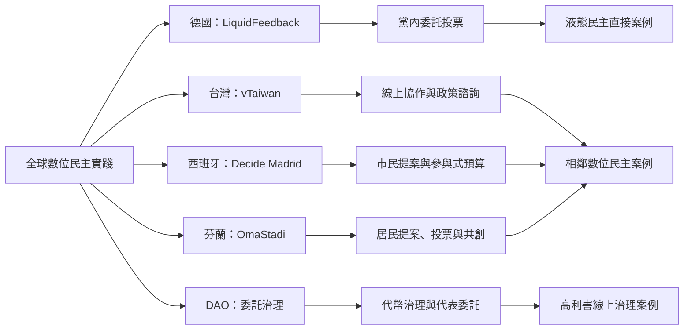

國際案例應區分真正包含可轉委託的制度，與相鄰的數位公民參與平台。德國海盜黨的 LiquidFeedback 是典型委託投票實作；台灣 vTaiwan、馬德里 Decide Madrid、赫爾辛基 OmaStadi 則是數位審議、市民提案或參與式預算的重要比較案例。

## 參考
* [[LiquidFeedback把委託投票帶入德國海盜黨的組織實踐]]
* [[台北馬德里赫爾辛基的比較研究揭示城市民主平台的情境性]]
* [[DAO大樣本研究發現委託提高參與但投票仍偏低]]
* [[城市參與平台不能直接等同液態民主]]
