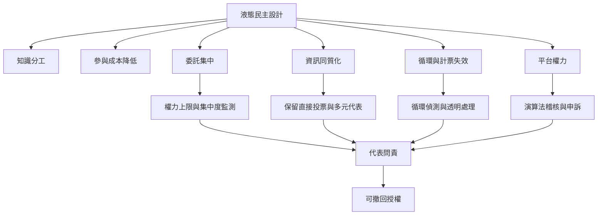

液態民主可降低參與門檻並讓知識分工成為可能，但委託過度集中、資訊來源減少、代表低參與、委託循環與平台演算法不透明，都可能削弱民主品質。制度保障需要同時處理權力分散、資訊多樣、撤回與問責、隱私和審議。

## 參考
* [[專家委託不會自動產生更好的群體判斷]]、[[委託可能減少群體中的獨立資訊來源]]、[[代表集中既可能提升協調也可能形成寡頭化]]、[[委託鏈的循環需要明確的制度處理規則]]、[[平台演算法也是民主制度的一部分]]、[[代表問責不能只依靠撤回按鈕]]。
