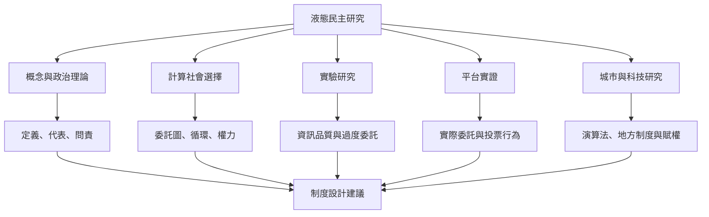

液態民主研究跨越政治理論、計算社會選擇、網絡科學、實驗經濟學、政治行為與科技研究。不同方法回答不同問題：概念分析界定制度邊界；形式模型分析委託規則；實驗研究檢驗資訊聚合；平台資料呈現真實行為；民族誌與訪談則說明制度如何嵌入地方脈絡。

## 參考
* [[液態民主的最低定義需要同時包含自願委託與代理投票]]
* [[2026年計算社會選擇研究整理出液態民主的模型分類]]
* [[兩項投票實驗顯示過度委託可能削弱集體判斷]]
* [[德國海盜黨的LiquidFeedback資料揭示超級委託者的權力問題]]
* [[vTaiwan與Decide Madrid的比較研究將演算法視為政治關係的一部分]]
