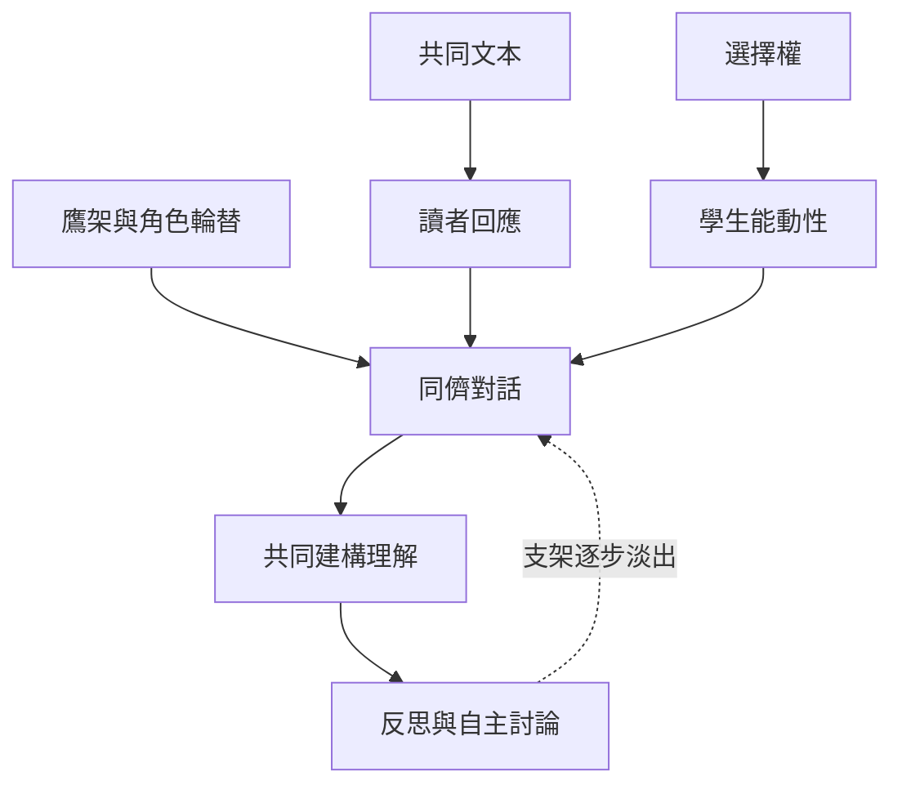

本圖整理文學圈作為教學協作形式的基本結構：選擇權提供自主，鷹架與角色輪替支援初期參與，對話式學習與讀者回應共同形成文本理解。當小組成熟，支架可逐步撤除。

核心筆記：[[文學圈是一種以共同文本與同儕對話為核心的閱讀協作形式]]、[[讀者的選擇權是維持閱讀動機與群體自主的重要條件]]、[[角色輪替能讓參與責任分散而不必固定分工]]。

## Mermaid 關係圖

## 參考
* [[Literature_Circle]]、[[Collaborative_Learning]]、[[Reader_Response_Theory]]、[[Transactional_Theory]]、[[Dialogic_Learning]]、[[Scaffolding]]、[[Student_Agency]]
* [[學生主導式文學圈以選擇權與角色輪替建立閱讀對話]]、[[台灣大學生研究顯示文學圈能促進高層次閱讀理解]]、[[韓國高中生研究指出討論主持角色受到學生歡迎]]

---
回到主題：[[Literature_circle]]
