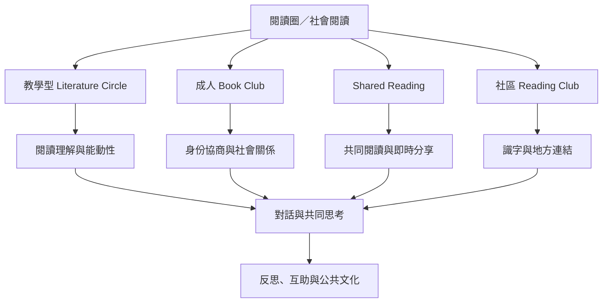

這張總覽圖將閱讀圈看作一個由文本、讀者、群體、場所與制度共同構成的實踐。教學型文學圈、成人讀書會、Shared Reading 與社區閱讀俱樂部不是同義詞，但可在自主、對話、文本理解、社會連結與公共參與等面向互相借鏡。

核心筆記：[[閱讀圈的價值不只在讀懂一本書也在學會共同思考]]、[[共同文本能讓不同動機的讀者維持可對話的共同基準]]、[[閱讀圈可以成為低門檻的社區連結場域]]。

## Mermaid 關係圖

## 參考
* [[Literature_Circle]]、[[Book_Club]]、[[Shared_Reading]]、[[Social_Reading]]、[[Bibliotherapy]]、[[Social_Prescribing]]
* [[文學圈教學設計與同儕對話概念地圖]]、[[社區共讀與公共閱讀基礎設施概念地圖]]、[[閱讀圈的包容性與權力關係概念地圖]]、[[閱讀圈研究證據與成效評估概念地圖]]

---
回到主題：[[Literature_circle]]
