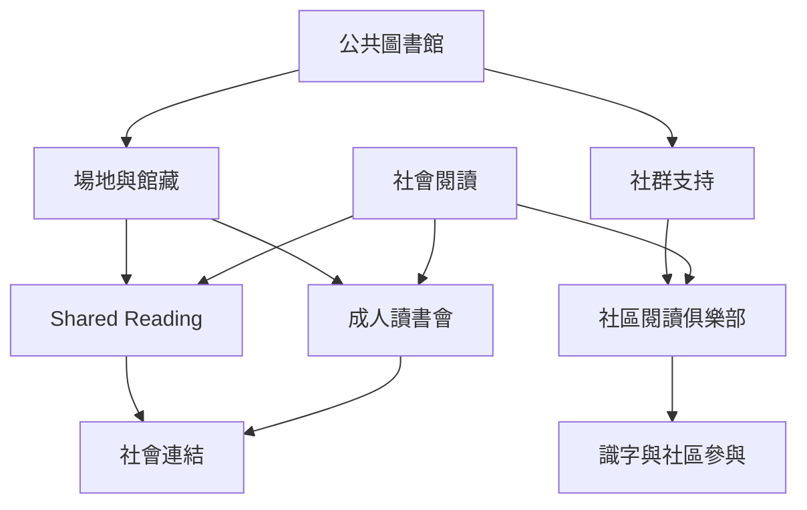

本圖呈現成人讀書會、Shared Reading、公共圖書館與社區閱讀俱樂部的關係。它們共享「閱讀是社會實踐」的觀點，但指定讀本、事前準備、朗讀方式與主持角色可能不同。公共圖書館與地方組織能提供場地、館藏與社群連結。

核心筆記：[[閱讀圈可以成為低門檻的社區連結場域]]、[[公共圖書館能為自組閱讀社群提供低成本基礎設施]]、[[安靜聆聽也應被承認為完整的參與方式]]。

## Mermaid 關係圖

## 參考
* [[Book_Club]]、[[Reading_Group]]、[[Shared_Reading]]、[[Social_Reading]]、[[Community_Literacy]]、[[Third_Place]]
* [[英國The Reader以朗讀與即時討論降低共讀門檻]]、[[澳洲公共圖書館以多樣化讀書會擴展社區閱讀文化]]、[[南非Nalibali閱讀俱樂部顯示社區閱讀的力量與永續挑戰]]

---
回到主題：[[Literature_circle]]
